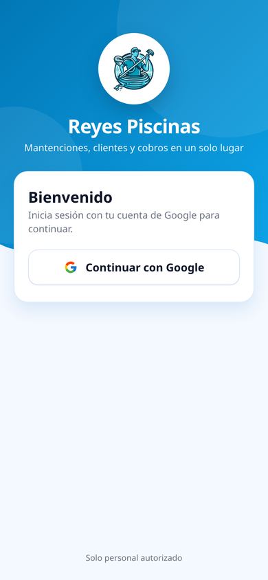
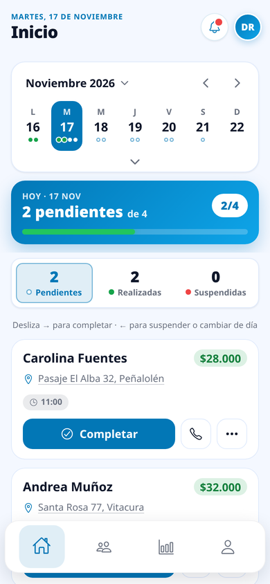
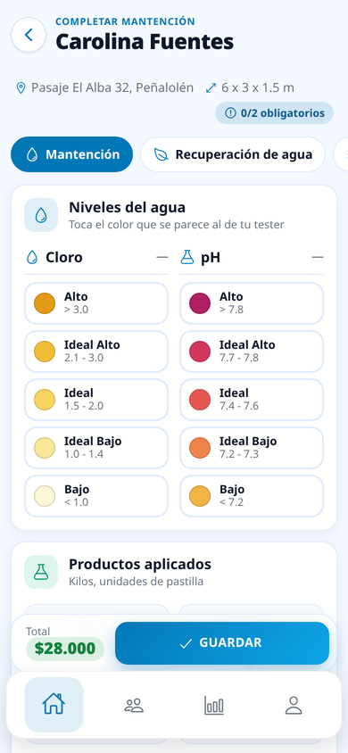
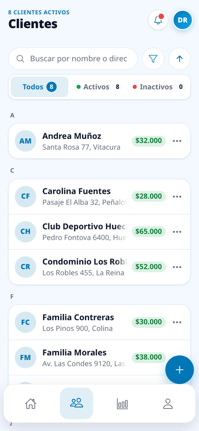
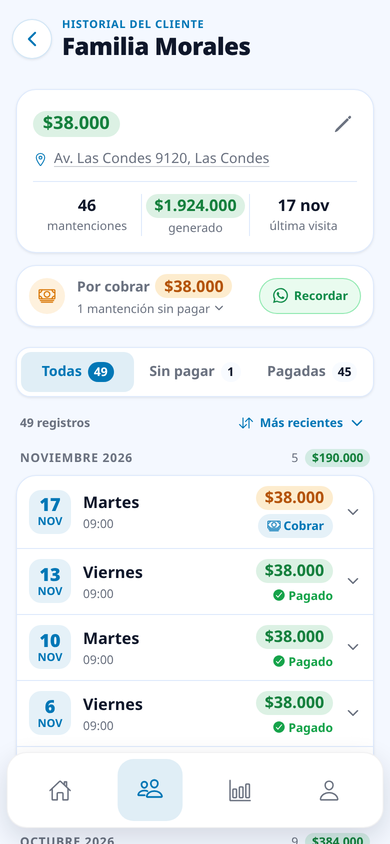
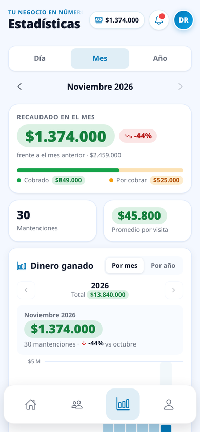
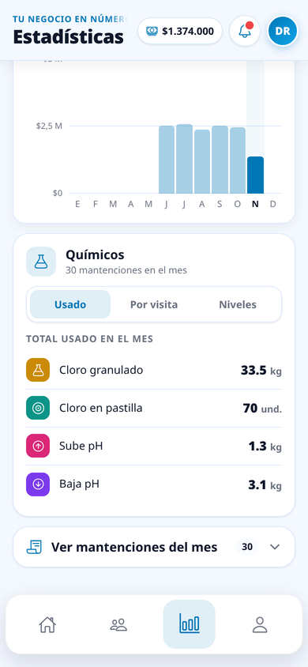
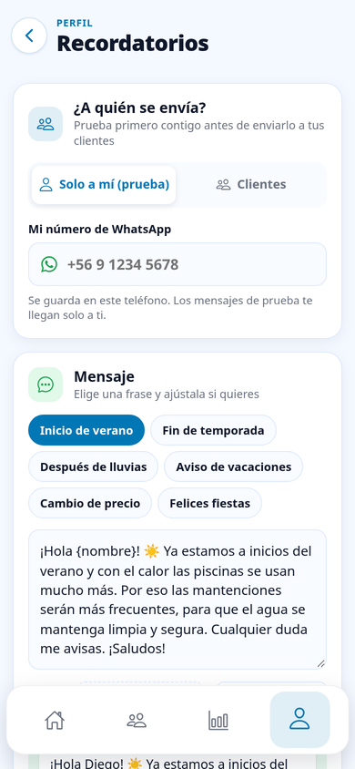

# Reyes Piscinas

**Aplicación móvil para gestionar una empresa de mantenimiento de piscinas:** clientes, agenda de mantenciones, niveles del agua, productos químicos y cobros en un solo lugar.

La creé por iniciativa propia para digitalizar el trabajo diario de Reyes Piscinas, una empresa de mantenimiento de piscinas en Santiago de Chile. Está pensada para que el equipo la use en terreno desde su celular Android, con la información sincronizada en tiempo real entre todos los dispositivos.


> Las capturas usan **datos ficticios**, cargados en los emuladores de Firebase. No muestran clientes reales.

---

## Capturas

| Inicio de sesión | Agenda del día | Completar mantención |
|:---:|:---:|:---:|
|  |  |  |
| Acceso solo para el equipo autorizado | Calendario semanal, progreso del día y pendientes | Niveles de cloro y pH según el color del tester |

| Clientes | Historial y cobros | Estadísticas |
|:---:|:---:|:---:|
|  |  |  |
| Búsqueda, filtros y precio de cada cliente | Mantenciones pagadas, por cobrar y recordatorio por WhatsApp | Recaudado, por cobrar y comparación con el mes anterior |

| Ingresos y químicos | Recordatorios por WhatsApp |
|:---:|:---:|
|  |  |
| Ingresos por mes y químicos usados (kg y unidades) | Plantillas de mensajes para avisar a los clientes |

---

## Funcionalidades

### Agenda y mantenciones
- **Calendario semanal** con indicadores por día: hechas, pendientes, suspendidas y cambiadas de día.
- **Lista del día** con progreso. Deslizas una tarjeta para completar, suspender o mover la mantención a otro día.
- **Registro de cada visita:** niveles de cloro y pH con la escala de colores del tester, y los productos aplicados (cloro granulado, pastillas, sube y baja pH, algicida).
- **Servicios especiales** con datos propios: recuperación de agua, cambio de cuarzo (tipo, kilos, material y mano de obra) y reparación de bomba (piezas reparadas, repuestos y costos).

### Clientes
- Ficha de cada cliente con dirección (se puede llenar con la ubicación del GPS), teléfono, medidas de la piscina, precio y días de visita.
- Búsqueda por nombre o dirección y filtro de clientes activos e inactivos.
- **Historial completo** de mantenciones, con el precio que se cobró ese día y su estado de pago.

### Cobros
- Se marcan las mantenciones pagadas y se ve lo que queda **por cobrar** de cada cliente.
- **Resumen de deuda por WhatsApp:** genera el mensaje con las fechas y los montos pendientes, listo para enviarlo al cliente.
- **Reportes al cliente:** al terminar una mantención se puede enviar el detalle de los químicos usados, el estado del agua y el valor.

### Estadísticas
- Recaudación por **día, mes y año**: cobrado, por cobrar, promedio por visita y comparación con el período anterior.
- Gráfico de **ingresos mensuales** y total anual.
- **Consumo de químicos** por período, por visita y niveles promedio, para saber cuánto producto comprar.

### Recordatorios y perfil
- **Plantillas de WhatsApp** para avisar a los clientes (inicio de verano, fin de temporada, después de lluvias, cambio de precio y otras), con un modo de prueba que envía el mensaje solo a tu número.
- Notificaciones locales de mantenciones y avisos de cobro.
- Modo oscuro.

---

## Arquitectura y decisiones técnicas

- **Angular 20 con componentes standalone** y carga diferida de cada pantalla (`loadComponent`).
- **Ionic 8 + Capacitor 7:** la misma base de código funciona en el navegador y como app nativa de Android (Google Sign-In nativo, geolocalización y notificaciones locales).
- **Firestore en tiempo real con un solo listener compartido:** `ClienteService.clientes$` mantiene una caché (`shareReplay`) que usan todas las pantallas. No se vuelve a descargar la colección en cada pantalla, y los cambios hechos desde otro dispositivo aparecen sin recargar.
- **Reglas de negocio centralizadas** (`src/app/utils/`): cálculos como "¿está pagada?", "¿cuánto se cobró?" o "¿se suspendió?" viven en un solo lugar. Así las pantallas no muestran montos distintos para el mismo dato.
- **Migración de datos idempotente:** `MigracionUnidadesService` convirtió de gramos a kilos los registros históricos. Marca cada registro, así que se puede reintentar sin convertir dos veces el mismo dato.

### Seguridad
- Inicio de sesión con **Google (Firebase Authentication)**. Solo entran cuentas con correo verificado que tengan un documento en la colección `equipo` de Firestore.
- **La lista de acceso no está en el código:** se administra desde la consola de Firebase. Cada persona solo puede leer su propio documento de `equipo`, así que nadie puede descargar la lista completa.
- **Reglas de Firestore** (`firestore.rules`) que hacen la misma comprobación en el servidor: cada usuario solo puede leer y modificar sus propios documentos. La validación de la app es solo visual; la que de verdad protege los datos es la del servidor.

---

## Tecnologías

| Área | Herramientas |
|---|---|
| Frontend | Angular 20, Ionic 8, TypeScript, RxJS, SCSS |
| Móvil | Capacitor 7 (Android), Google Sign-In nativo, Geolocation, Local Notifications |
| Backend | Firebase Authentication, Cloud Firestore, Firebase Hosting |
| Calidad | ESLint, Karma y Jasmine |

---

## Cómo ejecutarla

Requisitos: Node.js 20 o superior y un proyecto de Firebase propio (ver `FIREBASE_SETUP.md`).

```bash
npm install
npm start            # http://localhost:4200
```

### Android

```bash
npm run build
npx cap sync android
npx cap open android # luego Run en Android Studio
```

Para generar un APK de depuración: `cd android && ./gradlew assembleDebug`. Hay más detalles (Java, Google Sign-In, `google-services.json`) en [`CORRER_APP.md`](CORRER_APP.md).

---

## Autor

**Diego Reyes Ponce**, desarrollador Full Stack.
[LinkedIn](https://linkedin.com/in/diegoreyesponce) · [GitHub](https://github.com/D13gx1)
